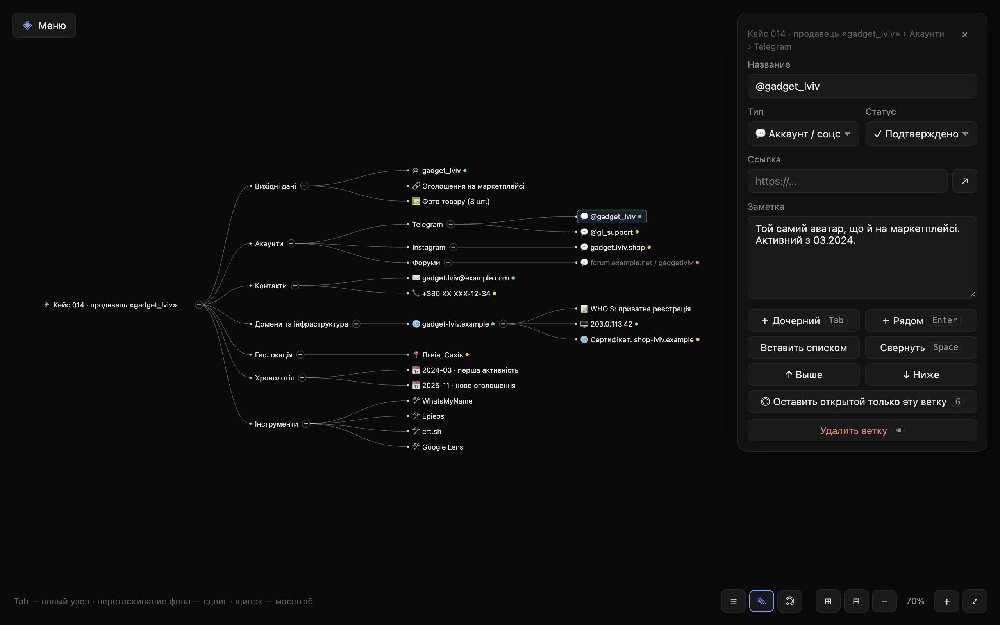
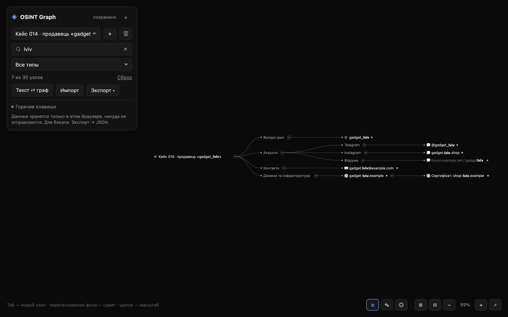
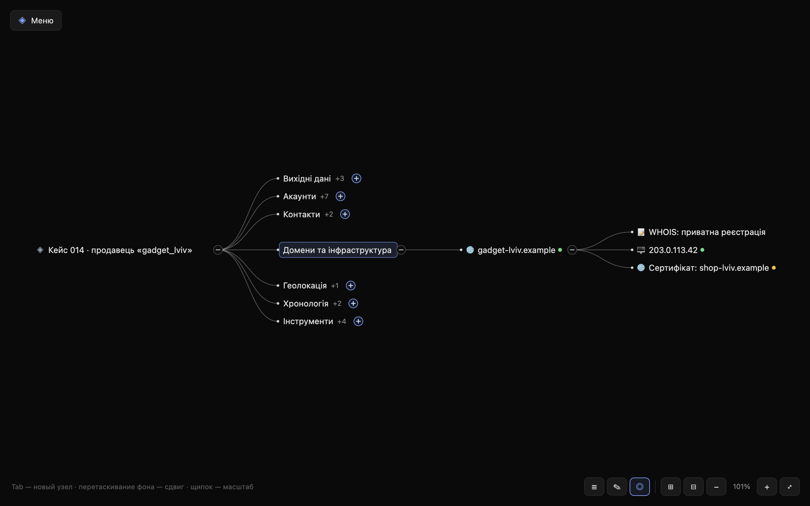
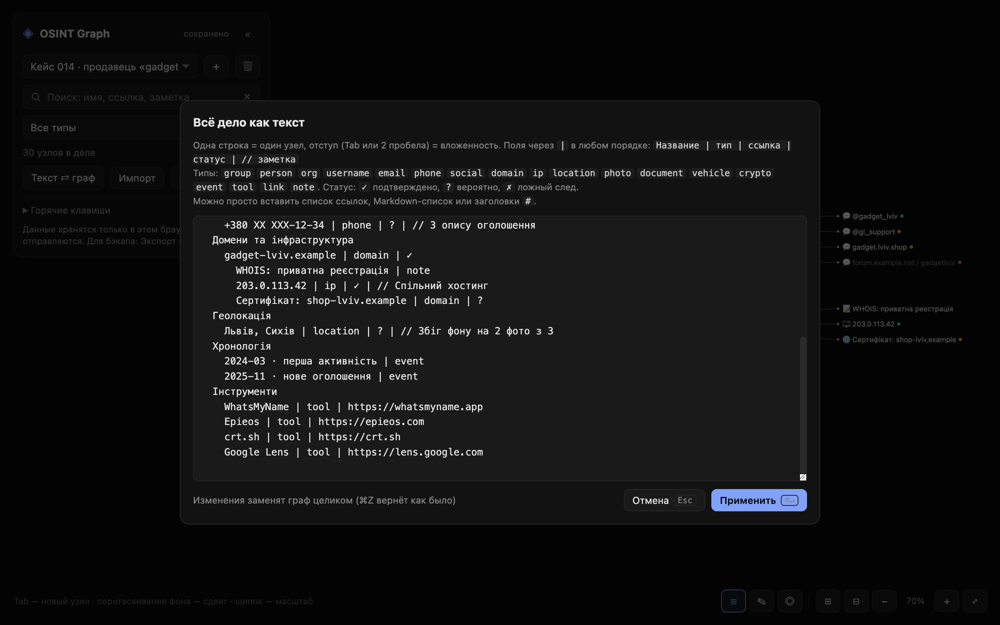

<div align="center">


# OSINT Graph

**Офлайн-редактор графів-дерев для OSINT-розслідувань.**
Збирай знахідки по справі в наочне дерево: акаунти, контакти, домени, геолокацію, хронологію, джерела.

[](https://github.com/radmorex/osint-graph/releases/latest)
[](https://github.com/radmorex/osint-graph/releases)

[](LICENSE)

[**⬇ Завантажити**](https://github.com/radmorex/osint-graph/releases/latest) · [English](#english) · [Як користуватись](#як-користуватись) · [Гарячі клавіші](#гарячі-клавіші)



</div>

---

## Що це

Схоже на Obsidian чи mind map, але заточене під OSINT. Дерево росте зліва направо, гілки з'єднані плавними лініями, а кожен вузол має тип, посилання, статус перевірки та нотатку.

- 🌳 **Граф-дерево.** Справа → розділи → знахідки, з будь-якою вкладеністю.
- 🏷 **Типи вузлів з іконками:** персона, нікнейм, email, телефон, акаунт, домен, IP, місце, фото, документ, транспорт, крипто, подія, інструмент, джерело, нотатка.
- 🟢🟡🔴 **Статус перевірки:** підтверджено, ймовірно, хибний слід.
- ⊖ / ⊕ **Згортання гілок кнопками**, щоб не заважали, коли працюєш з іншою частиною справи.
- ◎ **Режим фокусу:** відкриваєш гілку, і сусідні закриваються самі. Клавіша `G` лишає відкритою тільки поточну гілку.
- 🔍 **Пошук** по назвах, посиланнях і нотатках, із підсвіткою збігів та фільтром за типом.
- 📋 **Вставка списком:** скопіюй посилання, Markdown-список або нотатки, натисни `⌘V`, і рядки стануть вузлами.
- 📝 **Режим «Текст ⇄ граф»:** уся справа як текст із відступами. Редагуєш текст, і граф перебудовується.
- 🖱 **Перетягування** вузла на інший, щоб перенести гілку. Скасування дій через `⌘Z`.
- 🗂 **Кілька справ** в одній програмі.
- 💾 **Автозбереження у файл** і щоденні резервні копії (зберігаються 30 останніх).
- 📤 **Експорт:** JSON (бекап), TXT, SVG та PNG для звітів. **Імпорт:** JSON (зокрема дерево у форматі [OSINT Framework](https://github.com/lockfale/OSINT-Framework)), TXT, Markdown.
- 🔒 **Жодної мережі.** Програма нічого не завантажує й нікуди не відправляє (див. [Приватність](#приватність)).

<table>
<tr>
<td width="50%"><br><sub><b>Пошук:</b> лишаються тільки знайдені вузли та шлях до них, збіги виділено жирним.</sub></td>
<td width="50%"><br><sub><b>Фокус і сховані панелі:</b> інші гілки згорнуті (<code>+3 ⊕</code>), панелі ховаються клавішею <code>H</code>.</sub></td>
</tr>
<tr>
<td colspan="2"><br><sub><b>Текст ⇄ граф:</b> уся справа як текст. Відступ задає вкладеність, поля розділяються <code>|</code>.</sub></td>
</tr>
</table>

## Завантаження

Готові файли лежать на сторінці **[Releases](https://github.com/radmorex/osint-graph/releases/latest)**.

| Система | Файл | Примітка |
|---|---|---|
| **Windows 10/11** | `OSINT-Graph-…-Windows-Setup.exe` | інсталятор |
|  | `OSINT-Graph-…-Windows-Portable.exe` | без встановлення, можна з флешки |
| **macOS** (Apple Silicon M1–M4) | `OSINT-Graph-…-mac-arm64.dmg` | |
| **macOS** (Intel) | `OSINT-Graph-…-mac-x64.dmg` | |
| **Linux** | `OSINT-Graph-…-Linux-x86_64.AppImage` | будь-який дистрибутив |
|  | `OSINT-Graph-…-Linux-amd64.deb` | Debian / Ubuntu / Mint |

> [!NOTE]
> Збірки не підписані платним сертифікатом, тому під час першого запуску система попередить про невідомого розробника.
> - **Windows (SmartScreen):** «Додаткові відомості» → «Усе одно запустити».
> - **macOS:** відкрий програму, потім *Системні параметри → Конфіденційність і безпека → «Усе одно відкрити»*. Можна й так:
>   ```bash
>   xattr -dr com.apple.quarantine "/Applications/OSINT Graph.app"
>   ```
> - **Linux AppImage:** `chmod +x OSINT-Graph-*.AppImage`, потім запусти. На Ubuntu 22.04+ може знадобитися `sudo apt install libfuse2` (або `libfuse2t64` на 24.04+).
>   Для `.deb`: `sudo apt install ./OSINT-Graph-*.deb`
>
> Контрольні суми всіх файлів лежать у `SHA256SUMS.txt` у кожному релізі.

**Без встановлення.** Можна просто відкрити [`src/index.html`](src/index.html) у браузері. Усе працюватиме, тільки дані зберігатимуться в пам'яті браузера, тож не забувай робити Експорт → JSON.

## Як користуватись

1. Натисни **＋** зліва, щоб створити справу. Назва справи стає коренем дерева.
2. Клікни вузол і натисни **Tab**, щоб додати дочірній вузол, або **Enter**, щоб додати сусідній. Введи назву й натисни Enter.
3. У картці праворуч вибери **тип**, **статус**, вклади **посилання** (відкривається `⌘`+кліком по вузлу) і напиши **нотатку**.
4. Кнопки **⊖ / ⊕** біля гілок згортають і розгортають їх. Кнопка **◎** внизу вмикає режим фокусу.
5. **H** ховає обидві панелі, щоб лишився тільки граф. Кнопки **☰** і **✎** внизу ховають кожну панель окремо.

### Текстовий формат

Один рядок відповідає одному вузлу, а відступ (Tab або 2 пробіли) задає вкладеність. Поля розділяються `|` і можуть іти в будь-якому порядку:

```text
Кейс 014 · продавець «gadget_lviv»
  Акаунти
    Telegram
      @gadget_lviv | social | ✓ | // той самий аватар
      @gl_support | social | ?
  Домени
    gadget-lviv.example | domain | ✓
      203.0.113.42 | ip | ✓ | // спільний хостинг
  Інструменти
    WhatsMyName | tool | https://whatsmyname.app
```

- **Типи:** `person` `org` `username` `email` `phone` `social` `domain` `ip` `location` `photo` `document` `vehicle` `crypto` `event` `tool` `link` `note` `group`
- **Статус:** `✓` підтверджено · `?` ймовірно · `✗` хибний слід
- **Нотатка** починається з `//`

Також розуміє Markdown-списки, заголовки `#`, посилання `[текст](url)` і просто список URL.

### Гарячі клавіші

На Windows і Linux замість `⌘` використовуй `Ctrl`.

| Клавіша | Дія |
|---|---|
| `Tab` / `Enter` | додати дочірній / сусідній вузол |
| `F2`, подвійний клік | перейменувати |
| `⌫` / `Delete` | видалити гілку |
| `Space` | згорнути / розгорнути гілку |
| `G` | лишити відкритою тільки цю гілку |
| `H` | сховати / показати панелі |
| `← ↑ ↓ →` | ходити по графу |
| `Alt` + `↑ ↓` | переставити серед сусідів |
| перетягування вузла | перенести в іншу гілку |
| `⌘`+клік | відкрити посилання вузла |
| `⌘C` / `⌘X` / `⌘V` | копіювати / вирізати гілку як текст, вставити список |
| `⌘Z` / `⇧⌘Z` | скасувати / повернути |
| `/` або `⌘F` | пошук |
| `⌘S` | бекап справи в JSON |
| `F` | вписати граф в екран |
| щипок / `⌘` + коліщатко | масштаб |

## Де зберігаються дані

| Система | Файл |
|---|---|
| Windows | `%APPDATA%\OSINT Graph\data.json` |
| macOS | `~/Library/Application Support/OSINT Graph/data.json` |
| Linux | `~/.config/OSINT Graph/data.json` |

Поруч лежить папка `backups/`: одна копія на день, 30 останніх. Цю папку можна відкрити з меню програми: *Файл → Открыть папку с данными* (на macOS цей пункт у меню *OSINT Graph*).

Щоб тримати дані в іншому місці, наприклад на зашифрованому диску чи флешці, запусти програму зі змінною середовища:

```bash
OSINT_GRAPH_DATA_DIR="/Volumes/Secure/osint-graph" "/Applications/OSINT Graph.app/Contents/MacOS/OSINT Graph"
```

## Приватність

- Сторінка програми працює під жорсткою [Content-Security-Policy](src/index.html) (`default-src 'none'`). Вона фізично не може нічого завантажити з мережі чи кудись відправити.
- Немає телеметрії, аналітики, оновлень у фоні й іконок сайтів (favicon). Домени, з якими ти працюєш, нікуди не «світяться».
- Посилання з вузлів відкриваються в твоєму системному браузері тільки тоді, коли ти сам їх відкриєш.
- Electron-оболонка працює з `contextIsolation` і `sandbox`. Сторінка не має доступу до файлової системи, крім свого файлу даних і вікна «Зберегти як…».

## Збірка з вихідного коду

Потрібен [Node.js](https://nodejs.org) 20+.

```bash
git clone https://github.com/radmorex/osint-graph.git
cd osint-graph
npm install
npm start            # запустити програму
npm run dist         # зібрати інсталятор для поточної системи → dist/
npm run screenshots  # оновити скриншоти в docs/screenshots
```

Інсталятори для всіх трьох систем збирає **GitHub Actions** ([`.github/workflows/release.yml`](.github/workflows/release.yml)), коли пушиш тег:

```bash
git tag v1.0.1 && git push origin v1.0.1
```

**Легка нативна версія для macOS** важить ~300 КБ, бо зроблена на Swift + WKWebView без Electron. Вона використовує той самий файл даних:

```bash
./macos-native/build.sh   # → dist-native/OSINT Graph.app
```

### Структура

```
src/index.html        увесь інтерфейс: один файл без залежностей
electron/main.js      вікно, збереження у файл, бекапи, діалоги, меню
electron/preload.js   вузький міст між сторінкою та програмою
macos-native/         легка нативна обгортка для macOS (Swift)
scripts/screenshots.js  генерація скриншотів на вигаданому демо-кейсі
build/icon.png        іконка програми
```

## Плани

- [ ] Перемикач мови інтерфейсу (UA / EN / RU). Зараз інтерфейс російською.
- [ ] Перехресні зв'язки між вузлами різних гілок
- [ ] Вкладення файлів (скриншоти доказів) у вузли
- [ ] Шифрування файлу даних паролем

Ідеї та баги пиши в [Issues](https://github.com/radmorex/osint-graph/issues).

---

## English

**OSINT Graph** is an offline tree-graph editor for OSINT investigations, for **Windows, macOS and Linux**.

- Left-to-right tree with curved links; every node has a **type** (person, username, email, phone, account, domain, IP, location, photo, crypto…), a **link**, a **verification status** (confirmed / likely / false lead) and **notes**.
- **Collapse/expand buttons** on every branch, **focus mode** (opening a branch closes its siblings), **hide panels** with `H`.
- **Search** with match highlighting, **paste lists** (`⌘V` turns lines/URLs/Markdown into nodes), editable **text outline** of the whole case, drag-and-drop, undo.
- **Auto-save** to a local JSON file + daily backups. Export to JSON / TXT / SVG / PNG; import JSON (incl. OSINT Framework trees), TXT, Markdown.
- **No network access at all.** Strict CSP, no telemetry, no favicon fetching.

**Download:** [Releases](https://github.com/radmorex/osint-graph/releases/latest). Builds are unsigned, so see the note in [Завантаження](#завантаження) for first-launch warnings.
**Build:** `npm install && npm start`. The UI is currently in Russian; a language switch is planned.

## License

[MIT](LICENSE) © radmorex
